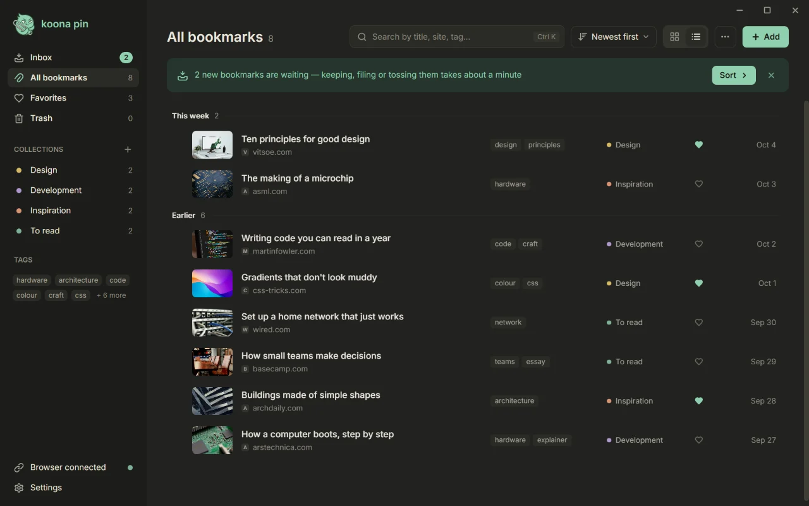

# Koona Pin

A desktop bookmark library. Save the page you are on from Chrome, Edge or Firefox with one button; the link lands in the app and stays on your computer.

Website and downloads: **[koona.app/pin](https://koona.app/pin/)**




## What it does

- **One-button capture.** The browser extension saves the current page to Koona Pin, even when the app window is closed. New links arrive in Inbox.
- **Inbox you can clear from the keyboard.** Keep, file or toss each new link with one key.
- **Collections, tags and favorites** to group links the way you think about them.
- **Search** across titles, sites and tags as you type; Ctrl K opens it from anywhere.
- **Grid and list views**, a light and a dark theme.
- **Trash** keeps deleted links for 30 days, so you can restore them.
- **Import and export.** Import the bookmarks file your browser exports; export to HTML, JSON or CSV.
- **Works offline.** The library is a file on your disk with automatic backups.
- **Updates** are checked once a day and installed only when you agree.
- **15 interface languages** (see [Translations](#translations)).

## Download

Get the current version from **[koona.app/pin/downloads](https://koona.app/pin/downloads/)**, which also lists SHA-256 checksums and install commands.

| Platform | Package | Notes |
| --- | --- | --- |
| Windows 11, 64-bit | Installer (`-setup.exe`) | No administrator rights needed |
| Ubuntu 26.04, Debian 13 | `.deb` | `sudo apt install ./<file>.deb` |
| Fedora 44 | `.rpm` | `sudo dnf install ./<file>.rpm` |
| Other Linux distributions | AppImage | Runs without installing |

Linux builds are 64-bit (x86_64) and target GNOME or KDE Plasma on Wayland. macOS and an Arch Linux (AUR) package are not available yet.

Windows may warn that it protected your PC, because the app is new: choose **More info**, then **Run anyway**.

## Browser extension

The extension works in Chrome or Edge 120+ and Firefox 140+ (including ESR 140). Install the app first; the extension talks only to Koona Pin on the same computer.

- **Chrome:** [Koona Pin in the Chrome Web Store](https://chromewebstore.google.com/detail/dedcgklilbgbieabgpklellnaccpjhpc).
- **Edge:** [Koona Pin in Edge Add-ons](https://microsoftedge.microsoft.com/addons/detail/ocdkndgdeagephdnlmofffbapdifhkho).
- **Firefox:** "Add to Firefox" on the [downloads page](https://koona.app/pin/downloads/#extension).

All three browsers are built from one source in [`extension/src`](extension/src).

## Privacy and where your data lives

Your library is a SQLite file on your computer:

| OS | Library file |
| --- | --- |
| Windows | `%APPDATA%\Koona\Pin\koonapin.db` |
| Linux | `~/.local/share/Koona/Pin/koonapin.db` (or `$XDG_DATA_HOME/Koona/Pin/`) |

Automatic backups go to a `backups` folder next to it. Uninstalling the Linux package keeps the library.

The app sends no analytics, telemetry or crash reports. It connects to the network only to read the title and preview of a link you save from that link's website, to ask Google's favicon service for missing site icons, and to ask koona.app once a day whether a new version is out. With Supporter, the optional subscription, it also asks the Koona server about your plan: while a purchase waits for its payment, once a day in the last days of a paid period, and when you sign in or out. The extension reads only the address and title of the tab you save. Feedback reaches the developer only if you choose to send it; a Supporter purchase sends them the email you paid with. Details: [privacy policy](https://koona.app/pin/privacy).

## Building from source

Koona Pin is a [Tauri 2](https://v2.tauri.app/) app: a Rust core with SQLite and a React 19 + TypeScript interface built with Vite.

### Prerequisites

- **[Bun](https://bun.sh/)**, the version in [`.bun-version`](.bun-version). Node.js is not needed; run every script with `bun run …`.
- **Rust** via [rustup](https://rustup.rs/). [`rust-toolchain.toml`](rust-toolchain.toml) pins the version and rustup installs it on first build.
- **Windows:** Microsoft C++ Build Tools and the WebView2 Runtime.
- **Linux:** the system packages for Tauri, installed by `bash scripts/linux/deps.sh` (Ubuntu, Debian, Fedora, Arch).

### Run

```sh
bun install
bun run tauri dev    # the desktop app with hot reload
bun run dev          # the interface alone in a browser, with demo data; it never touches your library
```

`bun run dev` starts the interface without the Rust core, which is handy for UI work.

### Checks

```sh
bun run check            # Rust tests, type check and build, Vitest; run before every commit
bun run check:bindings   # TypeScript bindings generated from Rust are committed
bun run test:ui          # Playwright tests of the interface
bun run test:native      # Playwright tests of the real app window (Windows, WebView2)
bun run test:extension   # the extension end to end against the app
bun run extension:lint   # web-ext lint of the Firefox build
```

Before the Playwright tests run `bunx --bun playwright install chromium` once. Native and extension tests use their own temporary libraries and browser profiles, not yours; close a running Koona Pin first. The full list of checks and their requirements is in [docs/testing.md](docs/testing.md).

Build output that leaves the repository (installers, packages, extension builds, release data) goes to `release/`, which Git ignores. `bun run clean` removes what tests leave behind.

## Repository layout

| Folder | What is in it |
| --- | --- |
| [`src/`](src) | The app interface: React 19, TypeScript, Tailwind CSS, interface strings in `src/locales` |
| [`src-tauri/`](src-tauri) | The Rust core: SQLite library, capture from the browser, import and export, backups, updates |
| [`extension/`](extension) | The browser extension for Chrome, Edge and Firefox (`extension/src`) and store assets |
| [`changelog/`](changelog) | What changed in each version: the release notes, the update dialog and the site's changelog page. The website [koona.app/pin](https://koona.app/pin/) itself lives in its own repository |
| [`supabase/`](supabase) | The backend that receives feedback sent from the app and the website |
| [`scripts/`](scripts) | Build, packaging, release and test scripts run by `bun run` |
| [`tests/`](tests) | Playwright tests of the interface and the native app, WebKitGTK tests for Linux, and fixtures |
| [`docs/`](docs) | Documentation: architecture, building, testing, the extension, translating, design and decisions |

## Translations

Interface strings live in [`src/locales/<code>.json`](src/locales). [`en.json`](src/locales/en.json) is the source and the fallback; every other file has the same keys, and a new file is picked up as a new language without code changes.

Languages: English, Chinese (Simplified), French, German, Italian, Japanese, Korean, Polish, Portuguese (Brazil), Russian, Serbian (Cyrillic and Latin), Spanish, Turkish and Ukrainian. `sr-Latn.json` is generated from `sr.json` with `bun run locales:sr-latn`.

## Contributing

Bug reports, ideas and questions go to [GitHub issues](https://github.com/andmetoo/koona-pin/issues/new/choose). Please open an issue before working on anything bigger than a fix. Pull requests need a signed [Contributor License Agreement](CLA.md): on your first one, the CLA check asks you to sign it with a single comment; authors keep their copyright. See [CONTRIBUTING.md](CONTRIBUTING.md).

## Security

Please don't report vulnerabilities in public issues. Use [private vulnerability reporting](https://github.com/andmetoo/koona-pin/security/advisories/new); see [SECURITY.md](SECURITY.md).

## License

Koona Pin is open core. Unless an applicable notice says otherwise, the community code — the app, the extension, the website, scripts, tests and documentation — is licensed under the [GNU General Public License v3.0 only](LICENSE) (`GPL-3.0-only`). Designated commercial code may be published in `commercial` directories under the separate [Koona Pin Commercial License](LICENSE-COMMERCIAL.md): public source is available for review and contributions, while production use requires an active subscription or another express permission. The price, currency and monthly or annual billing period are shown in Paddle checkout. This repository does not grant access to hosted services.

The names "Koona" and "Koona Pin", the mascot, the logo and the wordmark are used as trademarks; project-owned brand artwork, including the screenshots above, is excluded from the GPL. [TRADEMARKS.md](TRADEMARKS.md) permits local development, contribution forks, truthful references and redistribution of unmodified official community releases. A modified product distributed to end users must use its own branding. Third-party material, such as the Unsplash photos used in the screenshots, stays under its own terms.

Details: [LICENSING.md](LICENSING.md) and [TRADEMARKS.md](TRADEMARKS.md).

---

How the app is built, tested and translated, and the decisions behind it, are in [`docs/`](docs/README.md).
