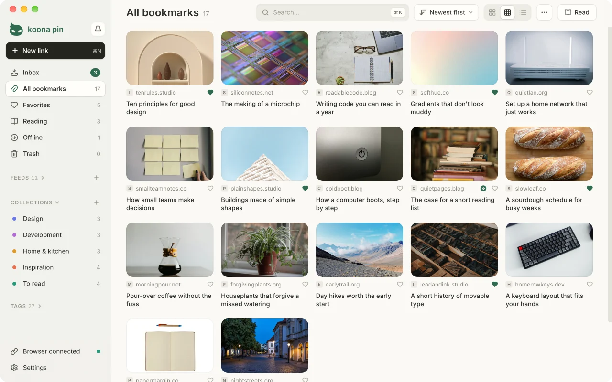
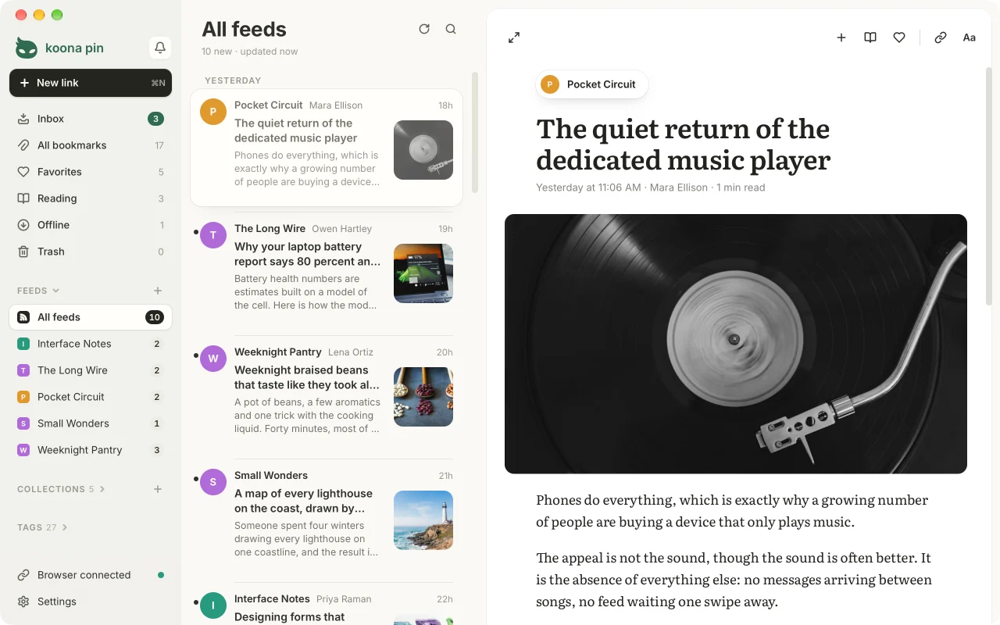
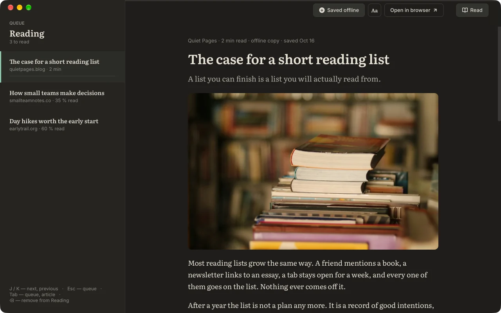

# Koona Pin

A desktop bookmark library for Windows, macOS and Linux. Save the page you are on from Chrome, Edge, Firefox or Safari with one button; the link lands in the app and stays on your computer. Read it later in reading mode, without menus or banners, and follow the sites you like through their feeds.

Website and downloads: **[koona.app/pin](https://koona.app/pin/)**







## What it does

- **One-button capture.** The browser extension saves the current page to Koona Pin, even when the app window is closed. New links arrive in Inbox.
- **New link, paste or drop.** «New link» at the top of the sidebar (⌘N on a Mac, Ctrl N elsewhere) shows the page's real title and picture before you save it, and offers to follow the site's feed. Paste a link anywhere in the library (⌘V or Ctrl V) or drop it onto the window to save it at once.
- **Inbox as a stack of cards.** Each new link sits on top of the next ones: ← moves it to the Trash, → keeps it, the heart adds it to Favorites. The collection where links from that site usually go is suggested.
- **Reading mode.** Saved articles open in one serif column, with the Reading queue beside them; J and K move between articles, Tab between the queue and the article, ⌫ takes an article out of Reading. The Aa panel sets text size, column width, font and theme. A title or Enter opens a bookmark in reading mode; when a page can't be shown as an article, it offers the browser instead.
- **A Reading list without a limit.** Send links there with R, from the card menu, or with «Save to Reading» in the extension (right-click a page or a link, or Alt+Shift+R). Reading remembers where you stopped.
- **Offline copies.** «Save for offline» keeps an article's text and pictures on your computer, to read without a connection; Settings can do it for every article you open from Reading (off by default). Copies are never uploaded or synced.
- **Feeds.** Follow a site's RSS, Atom or JSON feed and read new posts in three columns: feeds in the sidebar, the posts, and the article on a card with next and previous story. S saves a post, R sends it to Reading, F to Favorites, O opens it in the browser. A post becomes a bookmark only when you save it; unsaved posts are kept for 30 days. The app fetches feeds itself, straight from the sites, about once an hour or as often as you choose. Feeds import and export as OPML.
- **Collections, tags, favorites and notes** to group links the way you think about them.
- **Grid, compact grid and list views**, a light and a dark theme. A link without a picture shows the site's name on its cover. A click selects; the arrow keys move the selection and Shift extends it. Drag selected links onto a collection, a tag, Favorites, Reading or Trash.
- **Search** across titles, sites and tags as you type; Ctrl K (⌘K on a Mac) opens it from anywhere.
- **Housekeeping.** Find and merge duplicates, check for links that no longer open, refresh previews, and undo with Ctrl Z (⌘Z on a Mac).
- **Notifications** in one place: the bell in the sidebar collects new links waiting in Inbox, the offer to import from your browser and problems with saving from the browser.
- **Trash** keeps deleted links for 30 days, so you can restore them.
- **Import and export.** Import the bookmarks file your browser exports or an OPML file of feeds; export to HTML, JSON or CSV; keep a full JSON copy and restore from it. «Import a file…» in the ⋯ menu (drop a file on its window or click to choose one), or a file dropped on the list, works out which kind it is from what it holds.
- **Shareable lists.** Open a `.kpin` list of links and feeds someone published, see what it holds and choose what to import; make one in the bundle: drag bookmarks, collections, tags or feeds to it (or open it with «Share as list…» in the ⋯ menu and add the view on screen), then save it as a `.kpin` or copy it as Markdown. The bundle lives only while the app is open. The format is open and public domain: [docs/kpin](docs/kpin/README.md).
- **AI assistants.** Claude and other assistants on your computer can search your links and, if you allow it, save, tag, file and star them, through MCP. It is off until you turn it on, and nothing deletes ([how it works](docs/architecture.md#ai-assistants-mcp)).
- **Works offline.** The library is a file on your disk with automatic backups.
- **Lives in the tray** (the menu bar on a Mac) and can start with the system.
- **Updates** are checked once a day and installed only when you agree.
- **15 interface languages** (see [Translations](#translations)).

Koona Pin is free, and everything above stays free. **Supporter**, an optional subscription ($1.49 or €1.49 a month, $9.99 or €9.99 a year, or $29.99 or €29.99 once for Lifetime), funds the project and adds:

- **Sync between your computers**: bookmarks, collections, tags, the Reading list and where you stopped reading, and the feeds you follow. Posts and read marks stay on each computer. Sync is end-to-end encrypted and passes through a relay that stores nothing, so **it works only while Koona Pin is running on both computers at the same time**: changes wait on a computer until another one is online. One computer is the main one; another joins when you confirm a 6-digit code on the main one. Keep every computer up to date: after some updates sync pauses until all of them have the new version.
- **Automatic backups to a folder you choose**, such as a cloud drive.
- **The Paper and Sepia reading themes** and a Supporter badge.

See [pricing](https://koona.app/pin/pricing/).

## Download

Get the current version from **[koona.app/pin/downloads](https://koona.app/pin/downloads/)**, which also lists SHA-256 checksums and install commands.

| Platform | Package | Notes |
| --- | --- | --- |
| Windows 11, 64-bit | Installer (`-setup.exe`) | Signed; no administrator rights needed |
| macOS 15 or later, Apple Silicon | `.dmg` | Signed and notarized, updates itself; the Safari extension comes inside the app |
| Ubuntu 26.04, Debian 13 | `.deb` | `sudo apt install ./<file>.deb` |
| Fedora 44 | `.rpm` | `sudo dnf install ./<file>.rpm` |
| Other Linux distributions | AppImage | Runs without installing |

Linux builds are 64-bit (x86_64) and target GNOME or KDE Plasma on Wayland. An Arch Linux (AUR) package is not available yet.

## Browser extension

The extension works in Chrome or Edge 120+, Firefox 140+ (including ESR 140) and Safari 18.4+. Install the app first; the extension talks only to Koona Pin on the same computer.

- **Chrome:** [Koona Pin in the Chrome Web Store](https://chromewebstore.google.com/detail/dedcgklilbgbieabgpklellnaccpjhpc).
- **Edge:** [Koona Pin in Edge Add-ons](https://microsoftedge.microsoft.com/addons/detail/ocdkndgdeagephdnlmofffbapdifhkho).
- **Firefox:** "Add to Firefox" on the [downloads page](https://koona.app/pin/downloads/#extension).
- **Safari:** comes with the Mac app; turn it on in Safari → Settings → Extensions and allow it on websites.

The button saves the page you are on, «Save to Reading» (right-click, or Alt+Shift+R) sends it straight to Reading, and the popup searches your library. Every browser is built from one source in [`extension/src`](extension/src).

## Privacy and where your data lives

Your library is a SQLite file on your computer:

| OS | Library file |
| --- | --- |
| Windows | `%APPDATA%\Koona\Pin\koonapin.db` |
| macOS | `~/Library/Application Support/Koona/Pin/koonapin.db` |
| Linux | `~/.local/share/Koona/Pin/koonapin.db` (or `$XDG_DATA_HOME/Koona/Pin/`) |

Automatic backups go to a `backups` folder next to it. Feed posts are kept in `feeds.db` and offline copies in an `offline` folder in the same place; neither is synced or exported. Uninstalling the Linux package keeps the library.

The app sends no analytics, telemetry or crash reports. It connects to the network only to read the title and preview of a link you save from that link's website, to ask Google's favicon service for missing site icons, and to ask koona.app once a day whether a new version is out. Reading mode requests the page you open from its website, and the next article in the queue ahead of time while reading mode is open. It also requests the feeds you follow from their websites, about once an hour while it runs (nothing goes through a Koona server), the links the link check tests, the pictures of an article you save for offline, and, when you paste a link into «New link» (or, on a phone, type one and press Go), that page, to show its preview and whether it has a feed, and, when that page names no feed, the same site's home page. With Supporter, the optional subscription, it also asks the Koona server about your plan: while a purchase waits for its payment, once a day in the last days of a paid period, when you sign in or out, and, while sync is on, for a sign-in token for the sync relay. Sync carries your library between your computers through that relay, end-to-end encrypted with a key only your computers have, so the relay can't read it. The relay keeps nothing of your library and only passes changes between computers that are online at the same time. The extension reads only the address and title of the tab you save. Feedback reaches the developer only if you choose to send it; a Supporter purchase sends them the email you paid with. Details: [privacy policy](https://koona.app/pin/privacy).

## Building from source

Koona Pin is a [Tauri 2](https://v2.tauri.app/) app: a Rust core with SQLite and a React 19 + TypeScript interface built with Vite.

### Prerequisites

- **[Bun](https://bun.sh/)**, the version in [`.bun-version`](.bun-version). Node.js is not needed; run every script with `bun run …`.
- **Rust** via [rustup](https://rustup.rs/). [`rust-toolchain.toml`](rust-toolchain.toml) pins the version and rustup installs it on first build.
- **Windows:** Microsoft C++ Build Tools and the WebView2 Runtime.
- **Linux:** the system packages for Tauri, installed by `bash scripts/linux/deps.sh` (Ubuntu, Debian, Fedora, Arch).

### Run

```sh
bun install
bun run tauri dev    # the desktop app with hot reload
bun run dev          # the interface alone in a browser, with demo data; it never touches your library
```

`bun run dev` starts the interface without the Rust core, which is handy for UI work.

### Checks

```sh
bun run check            # Rust tests, type check and build, Vitest; run before every commit
bun run check:bindings   # TypeScript bindings generated from Rust are committed
bun run test:ui          # Playwright tests of the interface
bun run test:native      # Playwright tests of the real app window (Windows, WebView2)
bun run test:extension   # the extension end to end against the app
bun run extension:lint   # web-ext lint of the Firefox build
```

Before the Playwright tests run `bunx --bun playwright install chromium` once. Native and extension tests use their own temporary libraries and browser profiles, not yours; close a running Koona Pin first. The full list of checks and their requirements is in [docs/testing.md](docs/testing.md).

Build output that leaves the repository (installers, packages, extension builds, release data) goes to `release/`, which Git ignores. `bun run clean` removes what tests leave behind.

## Repository layout

| Folder | What is in it |
| --- | --- |
| [`src/`](src) | The app interface: React 19, TypeScript, Tailwind CSS, interface strings in `src/locales` |
| [`src-tauri/`](src-tauri) | The Rust core: SQLite library, capture from the browser, feeds, reading mode, import and export, backups, updates; sync and the backup folder in `commercial` directories |
| [`extension/`](extension) | The browser extension for Chrome, Edge, Firefox and Safari (`extension/src`) and store assets |
| [`changelog/`](changelog) | What changed in each version: the release notes, the update dialog and the site's changelog page. The website [koona.app/pin](https://koona.app/pin/) itself lives in its own repository |
| [`supabase/`](supabase) | The backend that receives feedback sent from the app and the website |
| [`scripts/`](scripts) | Build, packaging, release and test scripts run by `bun run` |
| [`tests/`](tests) | Playwright tests of the interface and the native app, WebKitGTK tests for Linux, and fixtures |
| [`docs/`](docs) | Documentation: architecture, building, testing, the extension, translating, design and decisions; the `.kpin` list format in [`docs/kpin`](docs/kpin/README.md) |

## Translations

Interface strings live in [`src/locales/<code>.json`](src/locales). [`en.json`](src/locales/en.json) is the source and the fallback; every other file has the same keys, and a new file is picked up as a new language without code changes.

Languages: English, Chinese (Simplified), French, German, Italian, Japanese, Korean, Polish, Portuguese (Brazil), Russian, Serbian (Cyrillic and Latin), Spanish, Turkish and Ukrainian. `sr-Latn.json` is generated from `sr.json` with `bun run locales:sr-latn`.

## Contributing

Bug reports, ideas and questions go to [GitHub issues](https://github.com/andmetoo/koona-pin/issues/new/choose). Please open an issue before working on anything bigger than a fix. Pull requests need a signed [Contributor License Agreement](CLA.md): on your first one, the CLA check asks you to sign it with a single comment; authors keep their copyright. See [CONTRIBUTING.md](CONTRIBUTING.md).

## Security

Please don't report vulnerabilities in public issues. Use [private vulnerability reporting](https://github.com/andmetoo/koona-pin/security/advisories/new); see [SECURITY.md](SECURITY.md).

## License

Koona Pin is open core. Unless an applicable notice says otherwise, the community code — the app, the extension, the website, scripts, tests and documentation — is licensed under the [GNU General Public License v3.0 only](LICENSE) (`GPL-3.0-only`). Designated commercial code may be published in `commercial` directories under the separate [Koona Pin Commercial License](LICENSE-COMMERCIAL.md): public source is available for review and contributions, while production use requires an active subscription or another express permission. The price, currency and monthly or annual billing period are shown in Paddle checkout. This repository does not grant access to hosted services.

The names "Koona" and "Koona Pin", the mascot, the logo and the wordmark are used as trademarks; project-owned brand artwork, including the screenshots above, is excluded from the GPL. [TRADEMARKS.md](TRADEMARKS.md) permits local development, contribution forks, truthful references and redistribution of unmodified official community releases. A modified product distributed to end users must use its own branding. Third-party material, such as the Unsplash photos used in the screenshots, stays under its own terms.

Details: [LICENSING.md](LICENSING.md) and [TRADEMARKS.md](TRADEMARKS.md).

---

How the app is built, tested and translated, and the decisions behind it, are in [`docs/`](docs/README.md).
