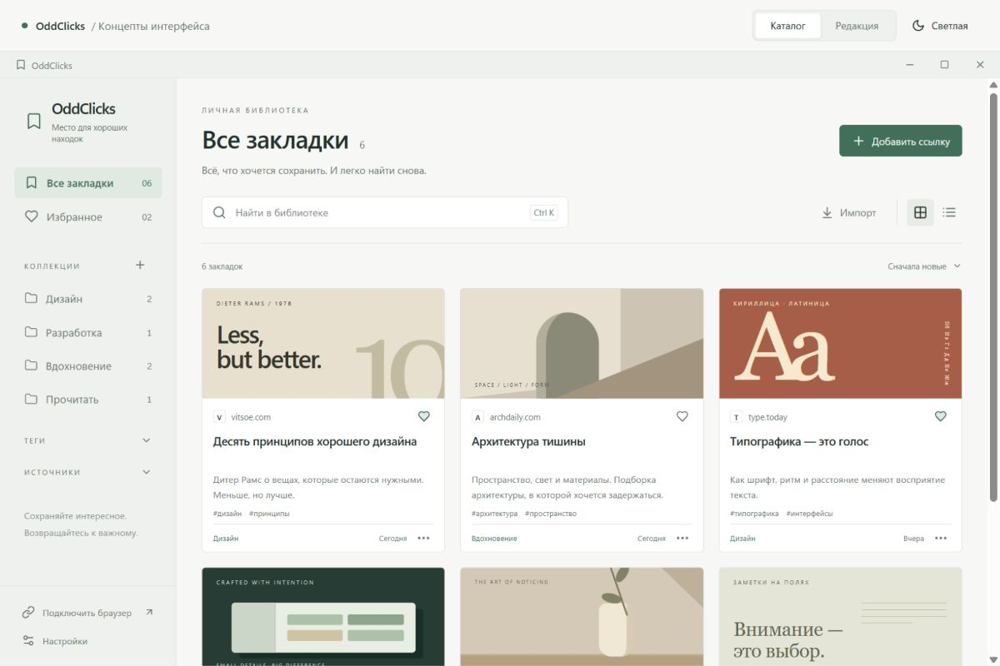
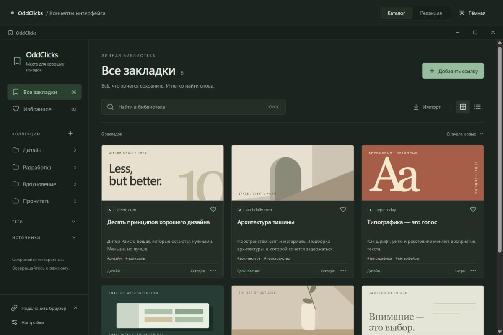
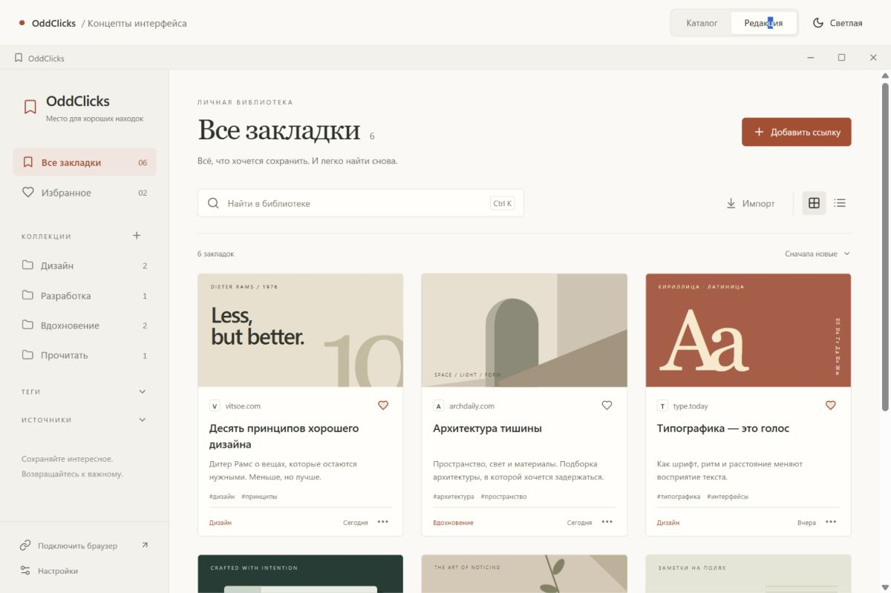
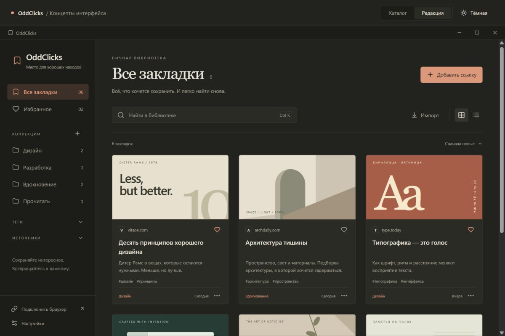
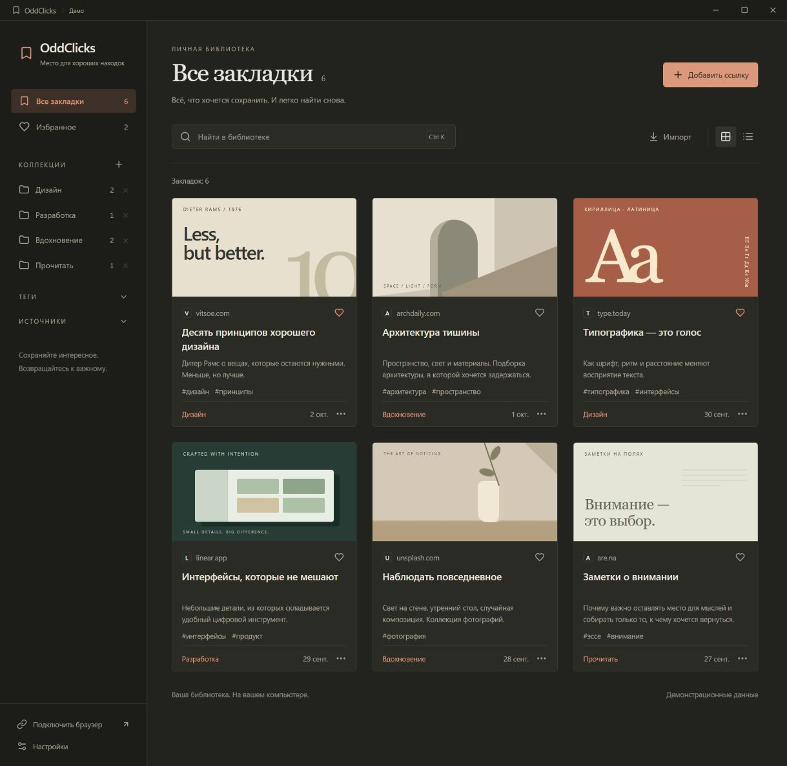
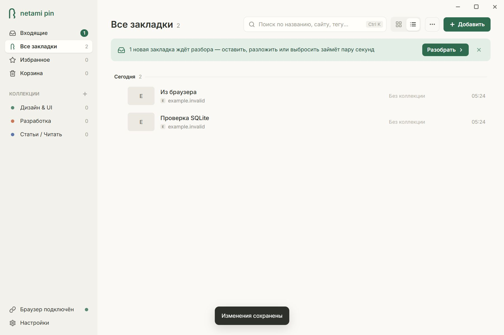
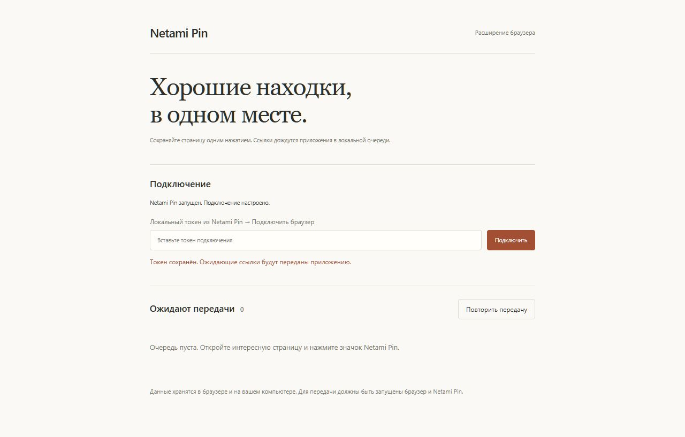

# Дизайн OddClicks

Пользователь выбрал **«Редакцию»** 2 октября 2026 года после сравнения двух концептов. Рабочее приложение использует тёплый фон, спокойные поверхности, терракотовый акцент, выразительный заголовок раздела и компактную навигацию.

Следующее направление — упрощённый интерфейс с разбором входящих и массовыми действиями: [redesign.md](redesign.md). Пока это макеты в Lunacy; описанное ниже остаётся фактическим состоянием приложения.

## Сравнимые концепты

Одинаковые шесть закладок, две темы, одинаковые сценарии. React-макеты: `src/concepts`; `/concept.html?direction=editorial&theme=light` открывает выбранное направление. Для второго: `direction=catalog`, для тёмной темы: `theme=dark`.

### Каталог

### Редакция — принятое направление

Иллюстрации демонстрационных карточек нарисованы HTML/CSS и не являются скриншотами внешних сайтов. Настоящие карточки показывают OpenGraph-изображение либо заглушку с доменом.

## Токены

Источник: `src/concepts/concepts.css`; дополнения рабочего UI: `src/production.css`. Прототип и приложение используют общие базовые стили полей, кнопок, карточек и диалогов.

| Токен                         | Светлая тема | Тёмная тема |
| ----------------------------- | ------------ | ----------- |
| Фон `--bg`                    | `#faf9f6`    | `#22221f`   |
| Панель `--panel`              | `#f2f1ec`    | `#1c1c19`   |
| Карточка `--card`             | `#fffefa`    | `#2b2b26`   |
| Текст `--ink`                 | `#2e302b`    | `#e9e6dc`   |
| Вторичный текст `--muted`     | `#74746a`    | `#a4a296`   |
| Линия `--line`                | `#deded5`    | `#3d3d35`   |
| Акцент `--accent`             | `#a34f34`    | `#db987a`   |
| Мягкий акцент `--accent-soft` | `#f1e6df`    | `#3d3028`   |
| Наведение `--hover`           | `#ece9e2`    | `#33332d`   |
| Ошибка `--danger`             | `#af3838`    | `#e99797`   |

Segoe UI Variable / Segoe UI — основной текст с кириллицей. Georgia — заголовки разделов и диалогов. Заголовок раздела 38 px, 29–33 px в узком окне; основной текст 12–13 px, заголовок карточки 15 px, метаданные 11 px.

Базовые интервалы: 4, 8, 12, 16, 24, 32 px. Радиус кнопок и карточек — 5 px, диалогов — 8 px. Строка окна — 32 px, боковая панель — 228 px (185–210 px в узком окне), встроенный редактор — 340 px. Сетка заполняет ширину колонками от 215 px; при открытом редакторе — от 190 px. Превью в списке — 130×98 px.

## Стабильность и движение

- Hover меняет цвет и границу за 140 мс. Карточки и изображения не сдвигаются и не масштабируются.
- Открытие редактора и диалога — 200 мс: прозрачность и смещение на 5 px. Уведомление — 180 мс, только прозрачность.
- Нет `transition: all`. При `prefers-reduced-motion: reduce` движение отключается.
- Под превью, две строки заголовка, две строки описания, теги и нижнюю строку зарезервирована высота. Ошибка изображения заменяет его заглушкой в том же контейнере.
- Сортировка по времени создания и идентификатору; метаданные не переставляют карточки. При прокрутке новые закладки ожидают отдельного действия.
- Видимый фокус — обводка акцентного цвета. Нативный `<dialog>` удерживает фокус; Escape и закрытие возвращают его.

Рабочий интерфейс с демонстрационными данными, тёмная тема:

Настоящий WebView2 (тестовые ссылки, текущий системный масштаб 150%):

